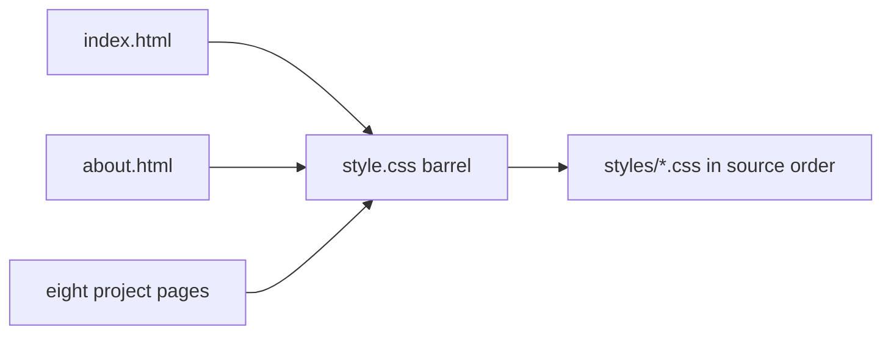
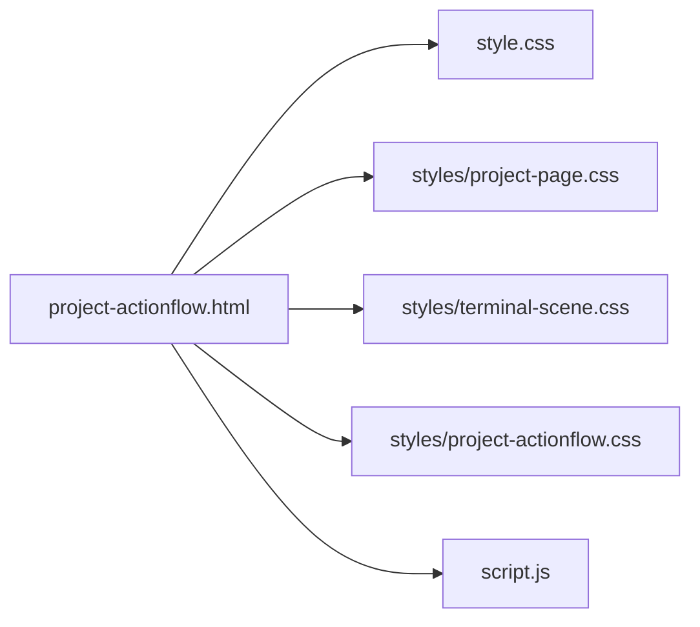
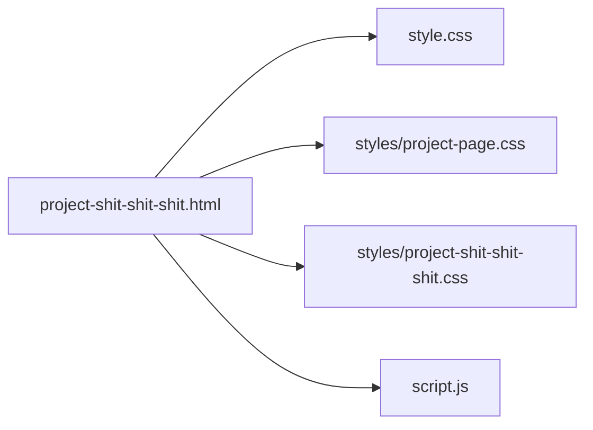
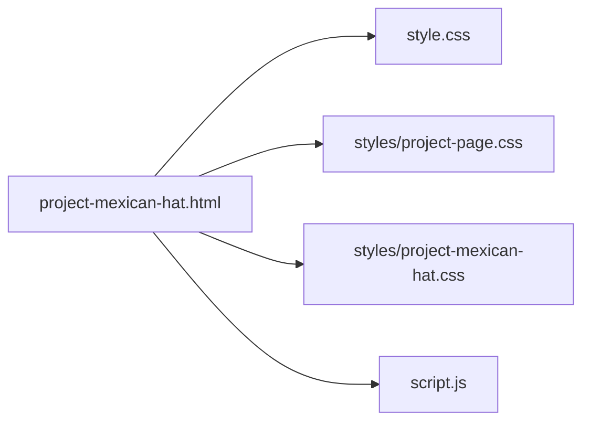
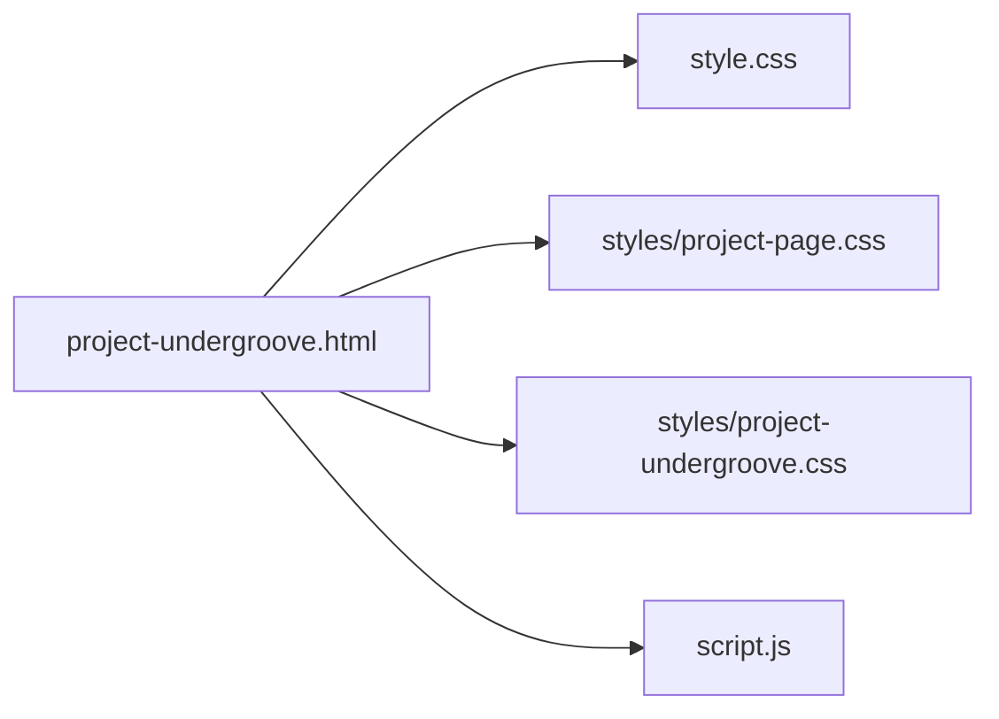
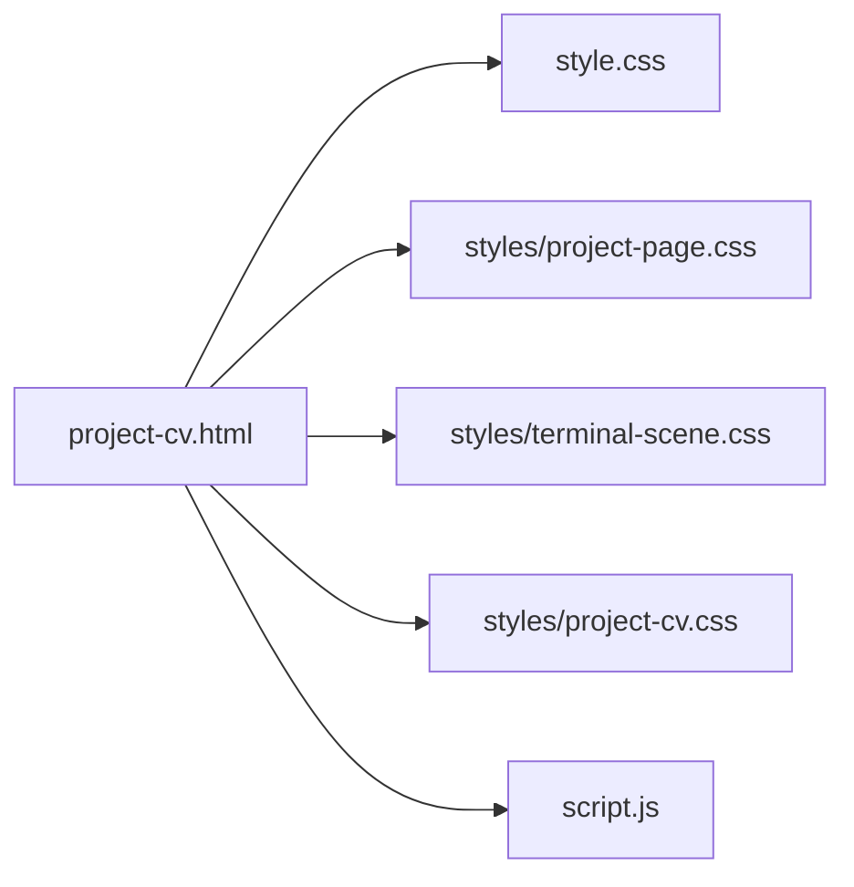
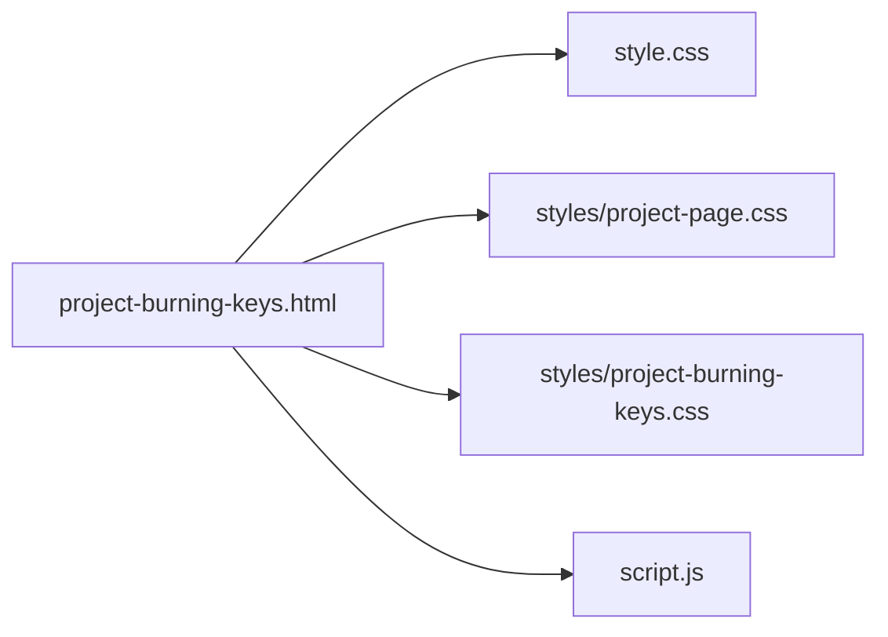
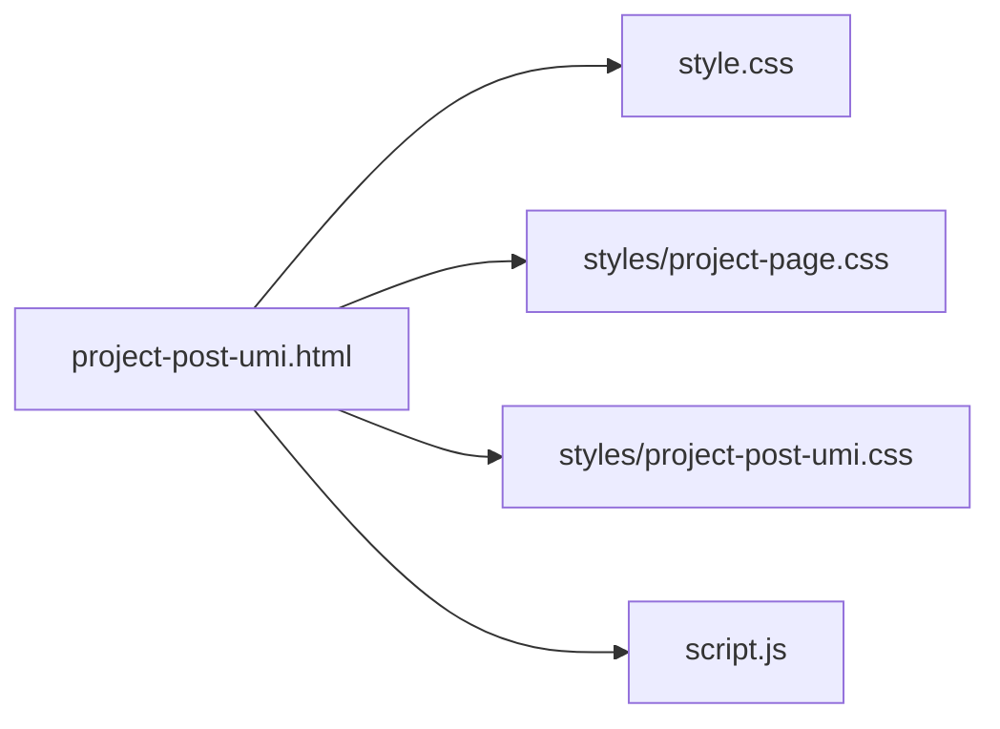
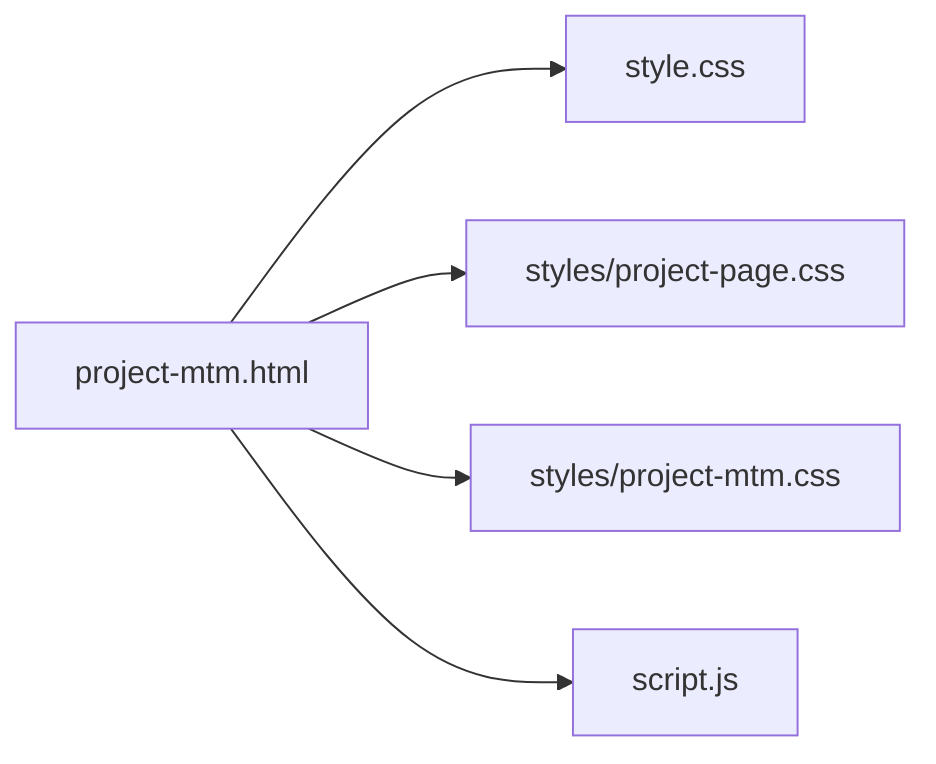
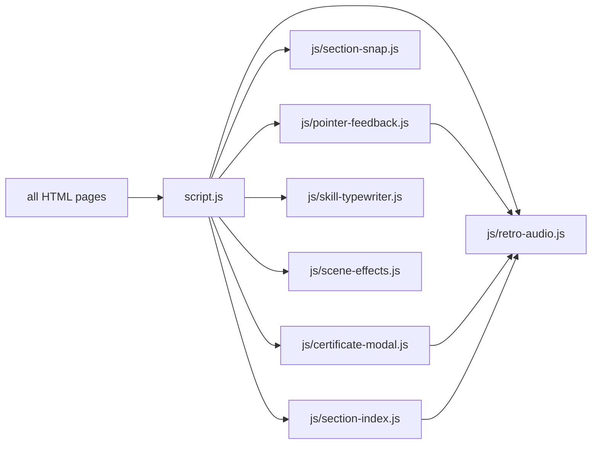

# Decomposition plan — CV portfolio

Scan root: `.` (repo root). Mode: plan. No product code has been changed.

> **Suggerimento**: prima di procedere, assicurati di avere un commit pulito o crea uno
> snapshot con `git stash` o `git commit -m "chore: pre-refactor snapshot"`.
>
> The working tree is already dirty (edited `about.html`, `index.html`, `style.css`, and untracked project pages plus images). Snapshot or commit that work before execution. This plan does not create a commit.

## Scan (literal)

```json
{"path":".","skipped":[],"threshold":400,"testThreshold":600,"targets":[{"lines":1457,"type":"CSS","file":"style.css","excess":1057},{"style":533,"type":"HTML","markup":391,"excess":530,"script":3,"lines":930,"file":"project-actionflow.html"},{"style":479,"type":"HTML","markup":272,"excess":357,"script":3,"lines":757,"file":"project-shit-shit-shit.html"},{"style":558,"type":"HTML","markup":139,"excess":303,"script":3,"lines":703,"file":"project-mexican-hat.html"},{"style":476,"type":"HTML","markup":209,"excess":291,"script":3,"lines":691,"file":"project-undergroove.html"},{"style":430,"type":"HTML","markup":164,"excess":200,"script":3,"lines":600,"file":"project-cv.html"},{"style":377,"type":"HTML","markup":196,"excess":179,"script":3,"lines":579,"file":"project-burning-keys.html"},{"style":418,"type":"HTML","markup":125,"excess":149,"script":3,"lines":549,"file":"project-post-umi.html"},{"style":356,"type":"HTML","markup":171,"excess":133,"script":3,"lines":533,"file":"project-mtm.html"},{"lines":523,"type":"JavaScript","file":"script.js","excess":123}]}
```

**Skipped:** none.

There is no `package.json`, `composer.json`, `manage.py`, `pyproject.toml`, `pytest.ini`, or `Cargo.toml`. Execution has no compile or test gate. The check is the bundled re-scan plus a browser pass on `index.html`, `about.html`, and one project page (desktop and a viewport under 1400px, where the index drawer takes over).

`index.html` and `about.html` are under the threshold. They stay as they are, except the `style.css` barrel (link unchanged) and the `script.js` boot tag.

## Structure groups

Project-page chrome (hero, notes, screenshots, index, actions) and the terminal scene (`project-cv.html` and `project-actionflow.html`) are the DRY cut already proposed on the HTML size targets below. The syntax-color lines inside `.code-block` match across three pages, but the block chrome (background, border, caption color) does not. That is a handful of identical declarations, not a module of its own.

Structure groups: none

## Size targets

### style.css — 1457 lines → target: barrel only + 17 section files

**Structural Complexity:** 0 classes, 0 functions, 0 exports. One stylesheet, 17 comment heads that name a component or a breakpoint sheet. The largest single rule is the `@media (max-width: 768px)` block at lines 1054–1385 (332 lines). It cannot be cut inside the braces.

**Current Responsibilities:**
1. Retro theme tokens and reset
2. Sticky scroll layers and scrollbars
3. Typography and retro buttons
4. Home project cards, including the terminal miniatures
5. About layout, bio, typewriter, timeline, certificates
6. Profile pixel, scroll hints, hobbies marquee
7. Phone overrides and the page-transition overlay

**Layer Violations:** none. Split by responsibility, between complete rules. The cut is the CSS rule-split: `style.css` becomes an `@import` barrel in source order. Pages that already link `style.css` stay unchanged. No comment above the first `@import` (there is no `@charset` and no font `@import` to preserve).

Heads that are one component share a file. A head that names a different component, or a breakpoint sheet, gets its own file even when it is short. Folding the 23-line phone queries at 865–887 into `certificates.css` would hang timeline and scroll-indicator overrides on the certificate component.

| File | Lines | What moves |
|------|-------|------------|
| `styles/design-tokens.css` | 1–13 | Palette and `html` scroll-snap |
| `styles/reset.css` | 14–27 | Box-sizing reset and `body` |
| `styles/scroll-layers.css` | 28–96 | `.layer`, parked layers, scrollport, `.content` |
| `styles/typography.css` | 97–119 | `h1`, `h2`, `p` |
| `styles/retro-button.css` | 120–141 | `.retro-btn` |
| `styles/project-cards.css` | 142–427 | Grid, cards, card visual, `.card-screen` |
| `styles/about-page.css` | 428–568 | About column, top nav, drawer breakpoints at 1399px / 1400px |
| `styles/bio-summary.css` | 569–614 | `.bio-box`, `.skills-grid` |
| `styles/skill-typewriter.css` | 615–641 | `.about-typed` |
| `styles/timeline.css` | 642–737 | Timeline, including the refinement heads |
| `styles/certificates.css` | 738–864 | Certificate scroller, gallery, modal |
| `styles/mobile-responsiveness.css` | 865–887 | The three short queries under that head |
| `styles/profile-pixel.css` | 888–919 | Profile pixel and `#intro` alignment |
| `styles/scroll-hint.css` | 920–983 | Chevron hints and the intro rules that sit before the hobbies banner |
| `styles/hobbies-marquee.css` | 984–1050 | Hobbies marquee |
| `styles/mobile-768.css` | 1051–1386 | The ≤768px sheet. Imported after every rule it overrides |
| `styles/page-transition.css` | 1387–1457 | `.page-transition-overlay` |

`styles/mobile-768.css` stays one file (one media rule, under 400). `styles/page-transition.css` stays last.

Execution writes `style.css.monolith.bak` beside the live file, then runs `scripts/verify-css-rule-split.ps1` until it prints `MATCH`. A line-count cut is not this split.

**Rules Compliance:**
- Driving principle: Separation of Concerns — one component (or one breakpoint sheet) per file, cascade order unchanged
- KISS/YAGNI: no token framework, no extra custom properties, no file whose name is absent from a source head. Short files (`design-tokens`, `reset`, `typography`, `retro-button`, `skill-typewriter`, `mobile-responsiveness`) stay because each head is a different job
- Naming: English kebab-case from the source heads (`mobile-768.css` for the ≤768 banner, `mobile-responsiveness.css` for the earlier banner)
- Composition: no inheritance

**DRY Opportunities:**
- None inside this file that is not already the section cut. Project-page chrome lives in the HTML targets, not here.

**Dependency Graph:**



**Risk:** Medium — `@import` order is the cascade. A section that starts with `}` or a range that splits a rule drops styles. The verify script is the gate, then a browser check that the first section (page background), a middle one (project cards), and the last one (transition overlay) still paint.
**Dependents affected:** every HTML page links `style.css`. The `href` stays `style.css`.

### project-actionflow.html — 930 lines → target: ~397 lines of markup + 2 stylesheets

**Structural Complexity:** 0 classes, 0 functions. Scanner: style 533, markup 391, script 3 (the `script.js` tag).

**Current Responsibilities:**
1. ActionFlow article markup
2. Shared project-page chrome, themed with `--term-*`
3. Page-only UI: terminal window, architecture diagram, action table, terminal backdrop

**Layer Violations:** the page theme is a `<style>` block in the document. Cut at the language boundary, then pull the chrome that is copied on the other project pages into one stylesheet.

**Proposed Decomposition:**
- Extract the shared chrome → `styles/project-page.css` (hero, section titles, highlight, notes, tech cards, screenshots, credits, actions, index nav, the 600px stack). Colors go through the custom properties the page already defines (`--term-black`, `--term-orange`, `--term-green`, `--term-gray`, `--term-line`, and the same roles on the other themes). Layout that is actually shared moves; a declaration that differs (ActionFlow’s `backdrop-filter` on `.index-nav`, split hover vs active) stays in the page file.
- Extract the terminal backdrop → `styles/terminal-scene.css`, shared with `project-cv.html` where the rules match.
- Extract the ActionFlow-only rules → `styles/project-actionflow.css` (`:root` tokens, terminal window, architecture diagram, action table, and any chrome override).
- Leave the article markup in `project-actionflow.html`. Add two `<link>` tags after `style.css`. Do not add a template engine or an `*-part2.html`.

Expected shared sheet is about 300 lines. If `styles/project-page.css` is still a scan target after the move, split it on its own heads in that same pass (hero, index, gallery). Do not leave a 500-line sheet beside a thin HTML file.

**Rules Compliance:**
- Driving principle: DRY plus the HTML language-boundary cut
- KISS/YAGNI: one shared sheet and one page sheet. No theme base class, no build step
- Naming: `project-page.css`, `terminal-scene.css`, `project-actionflow.css`
- Composition: plain stylesheets

**DRY Opportunities:**
- Project chrome copied in all eight `project-*.html` files → `styles/project-page.css`
- Terminal backdrop also in `project-cv.html` → `styles/terminal-scene.css`

**Dependency Graph:**



**Risk:** Medium — token names differ per page (`--term-orange` vs `--safety`). Mapping a color onto the wrong role changes the paint. Compare each moved rule with the page it came from before deleting the `<style>` block.
**Dependents affected:** this page only, plus `project-cv.html` for the terminal scene. `script.js` reads `.index-nav`, `.term-code-field`, `.screenshot-img`; those class names stay.

### project-shit-shit-shit.html — 757 lines → target: ~278 lines + `styles/project-shit-shit-shit.css`

**Structural Complexity:** style 479, markup 272, script 3.

**Current Responsibilities:**
1. Shit Shit Shit article
2. Shared project chrome
3. Theater backdrop and ember field (page-only)

**Layer Violations:** embedded `<style>`. Same chrome cut as `project-actionflow.html`.

**Proposed Decomposition:**
- Shared chrome already in `styles/project-page.css`
- Page tokens, code-block chrome, theater backdrop, ember field → `styles/project-shit-shit-shit.css`
- Markup stays in this file

The `.code-block` syntax colors match other pages; the block background and border do not. Those rules stay on this page. A 7-line color table is not its own module.

**Rules Compliance:**
- Driving principle: DRY, language boundary
- KISS/YAGNI: no shared code-block stylesheet
- Naming: `project-shit-shit-shit.css` matches the page
- Composition: plain stylesheet

**DRY Opportunities:**
- Chrome → `styles/project-page.css` (created with the ActionFlow row)

**Dependency Graph:**



**Risk:** Low — theater and ember rules are unique. Chrome move has the same token risk as ActionFlow.
**Dependents affected:** this page. `script.js` still queries `.ember-field`.

### project-mexican-hat.html — 703 lines → target: ~145 lines + `styles/project-mexican-hat.css`

**Structural Complexity:** style 558, markup 139, script 3.

**Current Responsibilities:**
1. Mexican Hat article
2. Shared project chrome
3. Fiesta backdrop (sombreros, sun, hat stack) — the bulk of the style block

**Layer Violations:** embedded `<style>`.

**Proposed Decomposition:**
- Shared chrome → `styles/project-page.css`
- `:root` fiesta tokens, hero placeholder, contrib list, fiesta scene → `styles/project-mexican-hat.css` (about 250 lines, under 400)

**Rules Compliance:**
- Driving principle: DRY, language boundary
- KISS/YAGNI: the fiesta scene stays one file; it is one backdrop
- Naming: `project-mexican-hat.css`
- Composition: plain stylesheet

**DRY Opportunities:**
- Chrome → `styles/project-page.css`

**Dependency Graph:**



**Risk:** Low — the long part is page-specific. Markup is already far under 400.
**Dependents affected:** this page.

### project-undergroove.html — 691 lines → target: ~215 lines + `styles/project-undergroove.css`

**Structural Complexity:** style 476, markup 209, script 3.

**Current Responsibilities:**
1. Undergroove article
2. Shared project chrome
3. Mycelium theme and its backdrop

**Layer Violations:** embedded `<style>`.

**Proposed Decomposition:**
- Shared chrome → `styles/project-page.css`
- Page tokens, code-block chrome, mycelium scene → `styles/project-undergroove.css`

**Rules Compliance:**
- Driving principle: DRY, language boundary
- KISS/YAGNI: no extra scene framework
- Naming: `project-undergroove.css`
- Composition: plain stylesheet

**DRY Opportunities:**
- Chrome → `styles/project-page.css`

**Dependency Graph:**



**Risk:** Low.
**Dependents affected:** this page.

### project-cv.html — 600 lines → target: ~170 lines + `styles/project-cv.css`

**Structural Complexity:** style 430, markup 164, script 3.

**Current Responsibilities:**
1. Portfolio-site article
2. Shared project chrome
3. Terminal window and the terminal backdrop (shared with ActionFlow)

**Layer Violations:** embedded `<style>`.

**Proposed Decomposition:**
- Shared chrome → `styles/project-page.css`
- Terminal backdrop → `styles/terminal-scene.css` (same module as ActionFlow)
- Page tokens and the terminal window rules that are not in the shared scene → `styles/project-cv.css`

**Rules Compliance:**
- Driving principle: DRY. The 430-line style block is not a Rule 2b exception; the chrome and the terminal scene are real second copies
- KISS/YAGNI: reuse `terminal-scene.css`; do not fork a second backdrop file to keep this page self-contained
- Naming: `project-cv.css`, `terminal-scene.css`
- Composition: plain stylesheets

**DRY Opportunities:**
- Chrome → `styles/project-page.css`
- `.term-bg` and glyph field → `styles/terminal-scene.css`

**Dependency Graph:**



**Risk:** Medium — the terminal scene must stay visually the same on both CV and ActionFlow. A property that exists on only one page stays in that page’s file.
**Dependents affected:** this page and `project-actionflow.html`.

### project-burning-keys.html — 579 lines → target: ~202 lines + `styles/project-burning-keys.css`

**Structural Complexity:** style 377, markup 196, script 3. The style block alone is under 400. The file is a target because the style and the article share one document.

**Current Responsibilities:**
1. Burning Keys article
2. Shared project chrome
3. Office backdrop and code-block chrome

**Layer Violations:** embedded `<style>`.

**Proposed Decomposition:**
- Shared chrome → `styles/project-page.css`
- Page tokens, office backdrop, code-block chrome → `styles/project-burning-keys.css` (the 377-line block shrinks once chrome leaves, so this file stays under 400)

**Rules Compliance:**
- Driving principle: DRY. Extracting the style tag alone would leave the duplicated chrome in an under-threshold file and miss the copy
- KISS/YAGNI: no further split of the office scene
- Naming: `project-burning-keys.css`
- Composition: plain stylesheet

**DRY Opportunities:**
- Chrome → `styles/project-page.css`

**Dependency Graph:**



**Risk:** Low.
**Dependents affected:** this page.

### project-post-umi.html — 549 lines → target: ~131 lines + `styles/project-post-umi.css`

**Structural Complexity:** style 418, markup 125, script 3.

**Current Responsibilities:**
1. Post Umi article
2. Shared project chrome
3. House-party backdrop

**Layer Violations:** embedded `<style>`.

**Proposed Decomposition:**
- Shared chrome → `styles/project-page.css`
- Page tokens and `.party-*` scene → `styles/project-post-umi.css`

The style block is only slightly over 400, and it is not one responsibility: chrome is shared, the party scene is not. Rule 2b does not apply.

**Rules Compliance:**
- Driving principle: DRY
- KISS/YAGNI: party scene stays one file
- Naming: `project-post-umi.css`
- Composition: plain stylesheet

**DRY Opportunities:**
- Chrome → `styles/project-page.css`

**Dependency Graph:**



**Risk:** Low.
**Dependents affected:** this page.

### project-mtm.html — 533 lines → target: ~177 lines + `styles/project-mtm.css`

**Structural Complexity:** style 356, markup 171, script 3. Style alone is under 400.

**Current Responsibilities:**
1. MTM VR article
2. Shared project chrome
3. Plant backdrop, video embed, screenshot captions

**Layer Violations:** embedded `<style>`.

**Proposed Decomposition:**
- Shared chrome → `styles/project-page.css`
- Page tokens, `.plant-bg`, video embed, captions → `styles/project-mtm.css`

**Rules Compliance:**
- Driving principle: DRY, same reason as Burning Keys
- KISS/YAGNI: plant backdrop is a few rules; it stays with the page theme file
- Naming: `project-mtm.css`
- Composition: plain stylesheet

**DRY Opportunities:**
- Chrome → `styles/project-page.css`. MTM’s index nav combines hover and active and skips `backdrop-filter`; that delta stays in `project-mtm.css`

**Dependency Graph:**



**Risk:** Low.
**Dependents affected:** this page.

### script.js — 523 lines → target: ~40 line boot + 7 modules

**Structural Complexity:** 0 classes, 2 top-level functions (`playRetroBeep`, `startPortfolio`), 0 exports. `startPortfolio` owns every behavior. Nested functions: `retroNavigate`, `snapTo`, `closeOverlay`, `render`, `type`, `readableLabel`, `setDrawerOpen`.

**Current Responsibilities:**
1. Web Audio beeps
2. Pointer sounds and in-site navigation overlay
3. Wheel snap between `.layer` sections
4. Certificate modal
5. About-page skill typewriter
6. Decorative fields (embers, terminal glyphs) and screenshot zoom
7. Project-page section index and nav drawer

**Layer Violations:** synthesis and DOM wiring share one function. The synthesizer moves out because the modal, the index, and the pointer handlers all call it. The rest splits by interaction, not by line count.

**Proposed Decomposition:**

There is no bundler. `script.js` becomes a module boot file. Each page’s existing tag changes to `<script type="module" src="script.js"></script>`. The tag is already at the end of `body`, and the boot still waits on `DOMContentLoaded` when `readyState` is `loading`. No second global script tag.

| Module | Approx. lines today | What moves |
|--------|---------------------|------------|
| `js/retro-audio.js` | 1–32 | `AudioContext` and `playRetroBeep` |
| `js/pointer-feedback.js` | 38–136 | Hover and click sounds, overlay, `retroNavigate` |
| `js/section-snap.js` | 138–190 | Wheel snap between layers |
| `js/certificate-modal.js` | 194–226 | `#cert-modal` open and close |
| `js/skill-typewriter.js` | 228–279 | `.skill-box` typewriter |
| `js/scene-effects.js` | 281–377 | Ember field, screenshot zoom, terminal glyphs. Three callers, one job: motion on existing scene nodes. Splitting the ember loop (~18 lines) or the glyph loop (~20) would be a single-consumer fragment |
| `js/section-index.js` | 379–516 | Index links, active section, drawer |
| `script.js` | 519–523 plus calls | Import the seven modules and call them in the current order |

`playRetroBeep` keeps its name and its default arguments. No try/catch added around the moved blocks. `console.log` at line 192 stays in the boot, after pointer feedback and section snap, where it sits today.

**Rules Compliance:**
- Driving principle: Single Responsibility. Audio is the mixed layer
- KISS/YAGNI: seven modules, not one file per `addEventListener`. Embers and glyphs stay together in `scene-effects.js`
- Naming: each file is the behavior it owns. No `utils.js`
- Composition: the boot calls the modules. No class hierarchy

**DRY Opportunities:**
- None. This file is the only copy.

**Dependency Graph:**



**Risk:** Medium — `type="module"` is deferred and scoped. Nothing else reads these globals today. A module that runs before `playRetroBeep` is initialized will throw; the boot must import audio first. Wheel snap uses a non-passive listener; that option stays.
**Dependents affected:** `index.html`, `about.html`, and all eight `project-*.html` files. Only the script tag changes.

## Execution order (after approval)

1. `style.css` (barrel; HTML links unchanged)
2. `script.js` (script tag on every page)
3. Project pages, shared sheet first: ActionFlow (creates `project-page.css` and `terminal-scene.css`), CV, then Shit Shit Shit, Mexican Hat, Undergroove, Burning Keys, Post Umi, MTM

One row finishes, then the same empty check suite is “run” (no stack signals), then the next row. Browser check after the CSS barrel and after the last project page.

## Final verification

Re-run:

```powershell
powershell -NoProfile -ExecutionPolicy Bypass -File "<skill-root>\scripts\scan-large-files.ps1" -Path . -Format json
```

Success means `targets` is empty, except a Rule 2b exception approved in chat. None is proposed now. `project-actionflow.html` markup is 391 lines; if the file is still a target after the style block leaves, stop and ask before splitting the article. A static include would be a build step this repo does not have.

Every structure group is done when the list stays empty (the DRY cuts above are the HTML rows, not a second list). A copy this refactor itself creates (the same block landing in two new files) is in scope and gets extracted before stopping. Do not open a new repo-wide duplicate search after that.

Then delete `.fhub-codebase-decomposer/` only after that gate passes.
